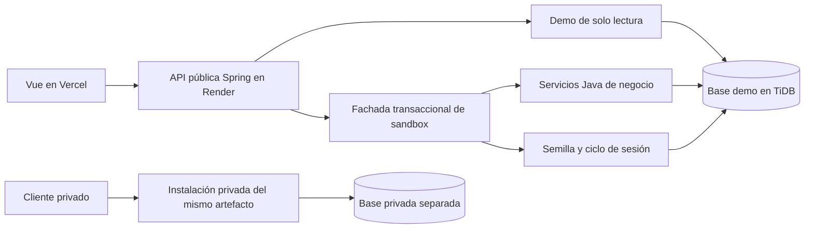
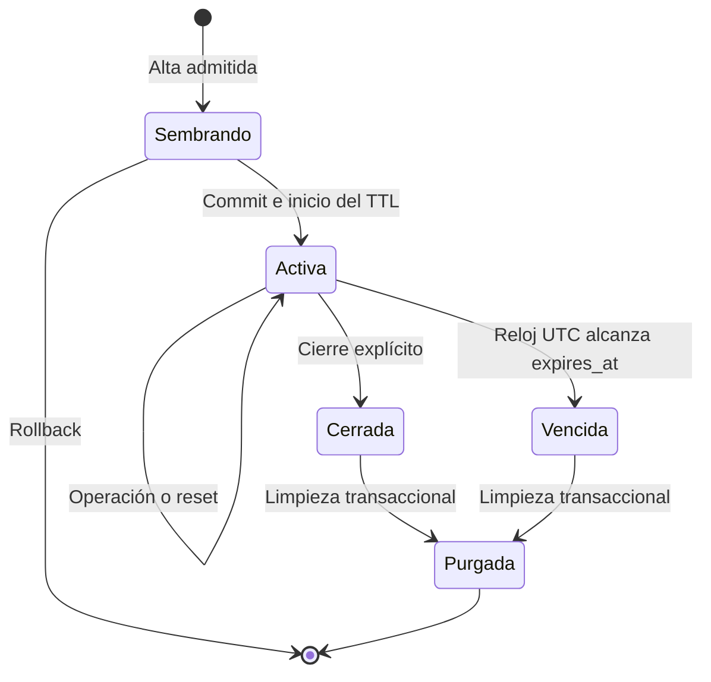

# Hogwarts Library V2.3 · Demo interactiva con sesiones aisladas

Auditoría y propuesta para decisión técnica · 26 de noviembre de 2026 · `feature/v2.2.1-hardening` · `e90decb`.

**Decisión propuesta.** Mantener una base exclusiva para la demo pública y aislar a sus visitantes con un `scope_id` obligatorio en los datos de negocio. Cada sesión tendrá una copia pequeña de la semilla, un JWT propio y 30 minutos de vigencia absoluta. Los servicios Spring existentes seguirán ejecutando todas las reglas de negocio. La demo de solo lectura conservará su semilla compartida y su entrada actual. La instalación privada usará su propia base, sus roles actuales y un único ámbito reservado.

## 1. Diagnóstico de la arquitectura actual

La SPA Vue 3 consume una API REST de Spring Boot 4.1.0 con Java 21, Spring Security, JPA/Hibernate y Connector/J. Los controladores validan los DTO, los servicios transaccionales resuelven las reglas, los repositorios exponen persistencia y los mappers construyen las respuestas. El hosting informado es Vercel Hobby para la SPA, Render Free para el contenedor y TiDB Cloud Starter para la base pública.

| Área | Estado observado |
| --- | --- |
| Entidades | Una `Categoria` agrupa varios libros y cada `Libro` tiene varios ejemplares. Libros y autores se relacionan N:M por `libro_autor`. Un `Cliente` puede tener varios alquileres y cada `Alquiler` tiene detalles y pagos. El detalle se guarda a través del alquiler y apunta a un `Ejemplar`. `SecuenciaCodigo` mantiene el contador `EJEMPLAR`. `Usuario` contiene las cuentas privadas. [Dominio](src/main/java/com/hogwarts/library/domain) |
| Repositorios | Nueve interfaces JPA. `findAll`, `findById`, `findAllById` y `existsById` operan sobre toda la base. También son globales las consultas por DNI, ISBN, código y nombres, los filtros por cliente/estado, el listado y la suma de pagos y las consultas con bloqueo de alquileres, ejemplares y secuencia. Las restricciones actuales impiden duplicados globales de DNI, ISBN, código, nombre de categoría y nombre de autor. Un JWT con identificador de sesión por sí solo dejaría intactos esos accesos. [Repositorios](src/main/java/com/hogwarts/library/repository) |
| REST y validación | Los siete controladores de negocio están activos en la demo. Los DTO ya validan campos obligatorios, longitudes, correo, IDs positivos en referencias, límites de fechas/listas y precisión/importe de dinero según la operación. El servicio completa las comprobaciones de existencia, unicidad, estados y saldos. Para la demo interactiva conviene acotar también tamaño total de JSON y cantidad de autores por libro, con límites específicos de la demo. [Controladores](src/main/java/com/hogwarts/library/controller) · [DTO](src/main/java/com/hogwarts/library/dto) · [Errores](src/main/java/com/hogwarts/library/exception) |
| Seguridad | `SecurityConfig` tiene una rama `demo` con lista explícita de `GET` y `POST /api/auth/demo`. El resto cae en `denyAll`. CORS demo admite `GET` y `POST` y exige orígenes HTTPS exactos en hosting. En privado, `ADMIN` y `EMPLEADO` operan el negocio. Las bajas de categorías, autores, clientes y libros, y las reactivaciones de clientes y libros, son administrativas. La regla `/api/usuarios/**` existe, pero el árbol auditado carece de un controlador de gestión de usuarios. [SecurityConfig.java](src/main/java/com/hogwarts/library/config/SecurityConfig.java) |
| Emisión y validación JWT | `DemoAuthController` emite un Bearer con `Cache-Control: no-store`. `DemoUserDetailsService` solo reconoce `visitante-demo` y asigna `ROLE_DEMO` sin insertar usuarios. `JwtService` firma con HMAC, exige un secreto de al menos 32 bytes y añade `sub`, `iat`, `exp` y `roles`. `JwtAuthenticationFilter` vuelve a cargar la identidad y sus autoridades, comprueba que esté habilitada y vuelve a analizar el token durante la validación. Hoy falta un identificador de sesión, una audiencia y un propósito verificables para separar clases de token. La duración demo predeterminada ya es 30 minutos. [Seguridad JWT](src/main/java/com/hogwarts/library/security) · [DemoAuthController.java](src/main/java/com/hogwarts/library/controller/DemoAuthController.java) |
| Perfiles | `dev` es predeterminado y usa MySQL local. `DataInitializer` solo aprovisiona cuentas si se ejecuta en desarrollo local y se proporcionan las contraseñas. `hosted` exige configuración externa y aplica TLS, pool y CORS de hosting. `prod` agrupa `hosted` y conserva autenticación privada. `demo` también agrupa `hosted`, selecciona el changelog demo y excluye el login privado y `CustomUserDetailsService`. `prod` se define por el grupo en `application.properties`. [Perfiles](src/main/resources) · [DataInitializer.java](src/main/java/com/hogwarts/library/config/DataInitializer.java) |
| Liquibase y semilla | El maestro incluye 8 changesets de base, 2 de secuencia y 4 de autores. Demo añade `demo-001-fictitious-library`, con guardas para el esquema exacto `hogwarts_library_demo` y tablas de negocio vacías en la carga inicial. El SQL usa IDs explícitos, fechas relativas a la primera instalación y fija el contador en 6. Contiene 3 categorías, 3 autores, 3 libros, 4 vínculos, 6 ejemplares, 3 clientes, 4 alquileres, 4 detalles y 3 pagos. Hay estados activo, vencido según fecha, finalizado y cancelado, y un alquiler activo con pago parcial. El informe anterior documenta la colisión de índices implícitos en TiDB y seis `validCheckSum` históricos exactos. [Changelogs](src/main/resources/db/changelog) · [Informe TiDB](TIDB_COMPATIBILITY_REPORT.md) |
| Contenedor y conexiones | Docker en dos etapas con imágenes Java 21 fijadas por digest, usuario `10001` y `MaxRAMPercentage=50`. El entrypoint admite un CA adicional mediante un truststore temporal. El build de la imagen empaqueta sin correr la suite. Hosting configura Hikari máximo 5, mínimo 1, adquisición 5 s, validación 2 s, conexión 5 s y socket 15 s, con `sslMode=VERIFY_IDENTITY`. Hibernate usa `validate` y `open-in-view=false`. `GET /healthz` comprueba readiness y `SELECT 1`, responde `200 UP` o `503 DOWN` y devuelve `no-store`. [Dockerfile](Dockerfile) · [Entrypoint](docker/entrypoint.sh) · [Configuración hosted](src/main/resources/application-hosted.properties) · [HealthController.java](src/main/java/com/hogwarts/library/controller/HealthController.java) |

**Alcance de la evidencia.** Los informes y XML existentes registran 74 pruebas exitosas, incluida la migración local MySQL. El informe TiDB del repositorio deja pendiente su validación remota posterior a la corrección de índices. La demo pública funcional y el arranque de aproximadamente 130 s provienen del contexto aportado. Esta auditoría se ejecutó en local, sin acceder a la base remota. La sección 14 distingue las pruebas repetidas de las futuras.

## 2. Funcionalidades existentes y reutilizables

| Función | Backend reutilizable | Pantallas y brechas |
| --- | --- | --- |
| Clientes | Alta, edición, consulta, baja lógica y reactivación. Normalización de DNI y comprobación de unicidad. | Lista, detalle y formulario. La edición se oculta a `DEMO`. Baja y reactivación usan permisos de administrador. |
| Libros | Alta, edición, consulta, baja lógica y reactivación. ISBN único, autores sin duplicados y verificación de categoría/autores activos según la operación. | Lista, detalle y formulario con selección de categoría y autores. Las bajas/reactivaciones se muestran según el rol privado. |
| Autores y categorías | Alta, edición, consulta y baja lógica. Normalización y validación de nombre. Los dos controladores publican `DELETE /{id}` para la baja lógica. | Listas y formularios. Autores tiene pantalla de detalle. Categorías se gestiona desde la lista y el formulario. |
| Ejemplares | Alta, edición, consulta y cambios de servicio. El alta genera `HOG-*` bajo bloqueo y comienza `DISPONIBLE`. El servicio verifica libro y bloquea cambios incompatibles con el estado alquilado. | Lista, detalle, formulario y filtros. La disponibilidad se presenta con datos que devuelve la API. |
| Alquileres | Alta, consulta general, detalle y consulta por cliente. Alta con cliente activo, ejemplares distintos disponibles, libros activos, hasta 3 ejemplares y 14 días con configuración actual. Calcula precios/subtotales en backend y bloquea ejemplares antes de asignarlos. `finalizar` registra devolución y libera ejemplares. `cancelar` transiciona desde `ACTIVO` y libera ejemplares. | Lista con filtros, alta y detalle con confirmaciones de devolución/cancelación. Los formularios de alta consumen clientes y ejemplares existentes. |
| Pagos | Registro y consultas de pago individual y por alquiler. Bloquea el alquiler, calcula el saldo, rechaza sobrepagos y alquileres cancelados. `EFECTIVO`, `TRANSFERENCIA` y `TARJETA` son valores del dominio. El servicio solo registra importes y observaciones en SQL. | Modal y listado en el detalle del alquiler, con total pagado y saldo. En sandbox debe rotularse la simulación y omitirse la captura de datos financieros. |
| Historial | Los listados actuales permiten ver alquileres, estados, detalles y pagos. Falta una cronología de cambios de clientes, catálogo y demás operaciones, así como el momento de cancelación como evento separado. | Reusar listas de negocio y agregar una vista de actividad transaccional con componentes comunes. |
| Dashboard | Falta un agregado REST dedicado. | `DashboardView` consulta clientes, libros, ejemplares y alquileres en paralelo al montar, y calcula tarjetas, estados y cinco recientes en el navegador. Reusar tarjetas y presentación, con datos acotados del servidor para la sesión. |
| Restaurar, caducar y limpiar | No existen para datos de negocio por visitante. | Agregar controles de sesión al layout y estados de expiración en la entrada. |

Evidencia de la matriz en [servicios de negocio](src/main/java/com/hogwarts/library/service/impl), [vistas Vue](frontend/src/views), [clientes Axios](frontend/src/api) y [router](frontend/src/router/index.ts).

**Restricciones exclusivas de la demo actual.** La rama demo de Spring Security bloquea cada escritura de las primeras seis filas. En Vue, `isDemo` oculta acciones y enlaces, `requiresWrite` redirige accesos directos y las acciones administrativas se comprueban por rol en vistas concretas. Los DTO, repositorios y reglas de negocio son compartidos. La separación real de permisos debe existir en la API aunque Vue oculte botones.

**Autenticación y arranque de la SPA.** `VITE_DEMO_MODE` habilita la entrada pública de `LoginView`, `auth.store.ts` conserva el Bearer y la respuesta en `sessionStorage` y comprueba `exp` para navegación. Axios añade el Bearer y maneja la pérdida de sesión por `401`. El timeout normal es de 15 s y el acceso demo ya usa 90 s con reintento manual. Ante los ~130 s informados para un arranque frío, ese POST puede vencer antes de que Spring esté listo. Se pueden reutilizar la pantalla, el mensaje accesible y el botón de reintento. [LoginView.vue](frontend/src/views/LoginView.vue) · [Store](frontend/src/stores/auth.store.ts) · [Axios](frontend/src/api/axios.ts) · [Auth API](frontend/src/api/auth.api.ts)

## 3. Comparación de alternativas de aislamiento

| Alternativa | Seguridad e integridad referencial | CPU, memoria, conexiones y almacenamiento | MySQL, TiDB, Liquibase y modo privado |
| --- | --- | --- | --- |
| A. Un ámbito por sandbox en las tablas de negocio | Las consultas explícitas por ámbito aíslan lecturas. FKs compuestas y unicidad local protegen relaciones y escrituras. Un predicado omitido sigue siendo un riesgo importante. | Un pool. Copias pequeñas e índices adicionales. Semilla y limpieza son DML acotado por sesión. | Compatible en principio con índices y FK compuestas. Un changelog común y un solo modelo. El modo privado requiere migración aditiva y pruebas de regresión. |
| B. Esquema independiente por sesión | Fuerte separación si cada identidad SQL tiene acceso exclusivo. Un usuario SQL compartido y cambio de catálogo por conexión reducen esa garantía. FKs existentes dentro de cada esquema. | DDL y Liquibase en cada alta, metadatos multiplicados. Pools por esquema excederían pronto el presupuesto. Un pool con routing exige verificar que las conexiones se restituyen incluso ante errores. | MySQL y TiDB admiten múltiples bases, pero aprovisionamiento, privilegios, versionado y limpieza por esquema son más costosos. El privado puede conservar su esquema y código de negocio con routing adicional. |
| C. Datos compartidos con reinicio periódico | FKs sencillas, con apariciones y modificaciones visibles entre visitantes. El reinicio puede interrumpir operaciones en curso. | Costo mínimo de filas. Mayor contención e impacto global en cada reinicio. | Sencillo en ambos motores y de bajo impacto sobre el privado si usa otra base. Incumple el aislamiento entre visitantes. |
| D1. Esquemas precargados de un conjunto fijo | Separación por esquema y asignación exclusiva con arrendamiento persistido. Requiere revocar toda sesión anterior antes de reciclar un esquema y verificar routing, transacciones y pool. | DDL fuera del alta. Duplicación de metadatos e historial de Liquibase por ranura. Capacidad rígida y limpieza por ranura. | Mantiene el modelo JPA actual. Obliga a migrar cada esquema, validar selección de catálogo y coordinar versiones. Alternativa si las FK y el mapeo de A bloquean el piloto. |
| D2. H2 efímero por sesión con servicios reales | Separación fuerte de datos si se garantiza el routing. Pérdida completa de la sesión ante suspensión o reinicio del proceso. | Filas, catálogos y metadatos en RAM por sesión. Carga de inicialización repetida dentro de 512 MB. | Las pruebas H2 existentes no demuestran paridad SQL ni de concurrencia con MySQL/TiDB. Aumenta las variantes operativas. Sería apropiado para pruebas sin persistencia. |

Para A, TiDB exige índices correspondientes en padres e hijos en el mismo orden de la FK, y genera un índice implícito si falta el del hijo. Esa condición y el bloqueo pesimista deben verificarse en la versión objetivo. [FK en TiDB](https://docs.pingcap.com/tidb/stable/foreign-key/) · [Modo pesimista de TiDB](https://docs.pingcap.com/tidb/stable/pessimistic-transaction/)

## 4. Arquitectura recomendada y justificación

Usar A para separar visitantes, con una segunda barrera entre la base pública y la base privada. Mantener el mismo artefacto Java y un pool por proceso. En el backend público, `demo` conserva lectura y activa la emisión sandbox solo mediante un flag independiente que arranca apagado. En privado se conserva `prod` o `dev`, sin rutas públicas de demo y con credenciales de otra base. Mantener el esquema público actual y verificar que la cuenta pública solo tenga permisos en ese esquema. Un error de filtrado entre sandboxes seguirá siendo importante, pero la cuenta pública tampoco tendrá acceso SQL a datos privados.

Separar los puntos de entrada de sandbox y los privados para que el cambio de permisos sea explícito. Los controladores sandbox delegan en las mismas interfaces de servicio y DTO. Una fachada transaccional de sandbox adquiere el ámbito, verifica sesión y generación, y ejecuta el servicio. El ámbito también se fija en cada consulta y relación. Los accesos privados y de solo lectura reciben su ámbito reservado desde el principal y el perfil. Ante contexto ausente, la persistencia falla antes de ejecutar SQL. Las operaciones de seed y limpieza tienen entradas internas dedicadas y verifican explícitamente el tipo de ámbito.

## 5. Modelo de datos propuesto

| Tabla o grupo | Diseño |
| --- | --- |
| `library_scope` | PK `BIGINT` interna, `tipo` (`LEGACY` o `SANDBOX`), creación, `expires_at` UTC, `closed_at` opcional, generación, fecha de negocio y versión de semilla. Mantiene los contadores acumulados y la última restauración. Una fila reservada con ID `1`, tipo `LEGACY`, por base. En público representa la semilla de lectura y en privado el contenido histórico. Sesiones nuevas reciben PK generada y `public_id` aleatorio único de 128 bits o más, sin significado de negocio. Índice `(tipo, expires_at, id)` y acceso indexado para cerradas. |
| `categoria`, `autor`, `libro`, `cliente`, `ejemplar`, `alquiler`, `detalle_alquiler`, `pago` | Columna `scope_id` obligatoria, FK al ámbito y PK originales `id` conservadas. Clave candidata única `(scope_id, id)` en los padres de FK compuestas y acceso por `(scope_id, id)` para listados/limpieza de cada entidad. La unicidad de nombre de categoría, nombre completo de autor, DNI, ISBN y código de ejemplar pasa a `(scope_id, valor)` usando las normalizaciones y collation existentes, comprobadas en ambos motores. |
| Relaciones de negocio | FK compuestas `(scope_id, categoria_id)`, `(scope_id, libro_id)`, `(scope_id, cliente_id)`, `(scope_id, alquiler_id)` y `(scope_id, ejemplar_id)` según cada relación. `libro_autor` lleva `scope_id` y dos FK `(scope_id, libro_id)` y `(scope_id, autor_id)`. Conservar unicidad de cada vínculo y de cada par alquiler/ejemplar, ahora con ámbito explícito. Indexar cada FK en el orden declarado y agregar índices de lecturas relevantes, como `(scope_id, alquiler_id, fecha, id)` para pagos. |
| `secuencia_codigo` | Migrar a PK `(scope_id, nombre)` y FK al ámbito. Preservar el último valor privado y el de la semilla histórica. Cada sandbox empieza con el valor máximo de su plantilla y continúa con el mismo generador bajo bloqueo, sin competir por un contador global. |
| `usuario` | Fuera del ámbito de sandbox. Conservar el modelo y repositorio privados. Los visitantes jamás crean registros en esta tabla. |
| `sandbox_event` | `scope_id`, generación, ID de evento, UTC, acción, tipo de recurso e ID del recurso. Índice `(scope_id, generacion, fecha, id)` para paginación con cursor. El ID de recurso es una referencia histórica sin FK al objeto. Se escribe en la misma transacción del negocio y se purga con la sesión. Evitar nombres, DNI, correo, observaciones y payloads. |
| Idempotencia y admisión | Fila de control de admisión inicializada por migración. Clave de reintento de alta registrada como digest único junto a la sesión. Tabla pequeña de mutaciones con clave única por `(scope_id, generacion, clave)`, huella de método/ruta/cuerpo y referencia a resultado. En reset, guardar la última clave y la generación resultante en el ámbito. Sin tokens ni cuerpos completos persistidos. |

Los IDs de las filas de negocio siguen siendo independientes del identificador público del sandbox. La versión inicial conserva el contrato numérico JSON actual de Vue, sujeto a verificar `BIGINT` dentro de `Number.MAX_SAFE_INTEGER` en el modo de asignación elegido y rechazar IDs de entrada fuera de rango en sandbox. Si los IDs del motor se acercan al límite, migrar el contrato público de sandbox a cadenas decimales antes de publicar. La autorización depende del ámbito autenticado incluso cuando un ID numérico es predecible.

## 6. Diseño de endpoints

Rutas nuevas únicamente en el perfil demo. Los verbos de negocio dentro de `/api/sandbox` replican los contratos REST y validaciones existentes. Las rutas privadas actuales y la entrada pública de lectura conservan sus contratos.

| Ruta | Acceso y respuesta |
| --- | --- |
| `POST /api/auth/demo` | Público con limitador. Devuelve el token de solo lectura con `200` y mantiene la conducta actual. |
| `POST /api/demo/sessions` | Público con limitador y flag. Exige `Idempotency-Key` de alta entropía. `201` tras la creación o `200` para replay de una alta que sigue vigente. Devuelve `token`, `tokenType`, `mode`, `expiresAt`, `generation` y capacidades. `429` por límite de frecuencia y `503` si la capacidad o la infraestructura impiden admitir sesiones. |
| `GET /api/demo/sessions/current` | Bearer sandbox. Devuelve expiración, generación, hora del servidor y capacidades vigentes. Permite reconciliar una recarga o un reset después de un timeout. |
| `POST /api/demo/sessions/current/reset` | Bearer sandbox con generación e idempotencia. `200` con nueva generación y la misma expiración. |
| `DELETE /api/demo/sessions/current` | Bearer sandbox con generación. Cierra la sesión y devuelve `204`. El cliente descarta su sesión aunque falle la red. Un intento posterior con sesión cerrada o purgada recibe el mismo `401` que un token inactivo. |
| `GET /api/sandbox/{recurso}` y `/api/sandbox/{recurso}/{id}` | Listas y detalles existentes para categorías, autores, clientes, libros, ejemplares y alquileres. Pagos conserva detalle individual y listado por alquiler. También se conserva alquileres por cliente. Usar métodos y segmentos exactos en Spring Security. |
| `POST /api/sandbox/{recurso}` / `PUT /api/sandbox/{recurso}/{id}` | Alta y edición para categorías, autores, clientes, libros y ejemplares. Alquileres y pagos aceptan `POST` para el alta sin incorporar edición genérica. |
| `DELETE /api/sandbox/{recurso}/{id}` | Baja lógica de categorías, autores, clientes y libros. |
| `PATCH /api/sandbox/clientes/{id}/reactivar` y `/api/sandbox/libros/{id}/reactivar` | Reactivaciones existentes. |
| `PATCH /api/sandbox/ejemplares/{id}/{acción}` | Solo `fuera-servicio` y `habilitar`. |
| `PATCH /api/sandbox/alquileres/{id}/{acción}` | Solo `finalizar` y `cancelar`. |
| `GET /api/sandbox/dashboard`, `GET /api/sandbox/historial` | Agregado consistente por sesión y actividad con cursor/orden estable. El historial muestra, entre otros, altas, ediciones, bajas lógicas, devoluciones, cancelaciones, pagos y reset. |
| `GET /healthz` | Readiness existente. Extender CORS exclusivamente para `GET` desde el origen público si será usado por la SPA. Mantener respuesta mínima, sin diagnóstico interno. |

Toda respuesta con datos de sesión lleva `Cache-Control: no-store`. Los `GET` de sandbox devuelven `X-Sandbox-Generation` para que la SPA descarte resultados anteriores a un reset. Las mutaciones requieren esa misma cabecera como precondición de versión, con `428` si falta y `412` si quedó desactualizada. La cabecera nunca selecciona el ámbito. Devolver `404` uniforme para recursos o referencias fuera de ámbito, `401` para autenticación inválida/inactiva, `403` para permiso insuficiente, `400` para entrada inválida, `409` para conflictos de estado, idempotencia o cupo de registros, `429` con `Retry-After` para frecuencia, y `503` con `Retry-After` cuando corresponda a saturación recuperable. Los errores preservan la forma de `ApiError` con un código estable para elevar al frontend. Las rutas privadas conservan sus códigos y payloads actuales.

## 7. Autenticación y autorización

- **Tres clases de identidad.** Conservar `ADMIN` y `EMPLEADO` privados. La demo de lectura sigue siendo `DEMO` y accede solo a su ámbito reservado. El principal `DEMO_SANDBOX` obtiene autoridades acotadas a la lista de rutas sandbox, incluidas bajas lógicas dentro de su sesión. Exigir modo, audiencia y propósito correctos antes de resolver el ámbito. Denegar por defecto en `SecurityConfig` y verificar sesión/ámbito también en la capa transaccional.
- **JWT sandbox.** Emitir `iss`, `aud`, `sub` opaco de sesión o `sid` opaco firmado, `jti`, `iat`, `nbf` si se utiliza, `exp` y propósito. Usar clave aleatoria propia de sandbox en la configuración de hosting y algoritmo permitido fijo. Validar el token una vez y derivar las autoridades del tipo aceptado en el servidor. Validar `exp` y también la vigencia efectiva de la fila. Política de rotación con clave anterior como máximo durante la vigencia de los tokens que se decida honrar, y revocación inmediata retirándola si corresponde. Nunca usar secretos privados en la demo pública. La ruta privada rechaza tokens sandbox y la ruta sandbox rechaza tokens privados o de solo lectura.
- **Datos de confianza.** El verificador transforma el identificador opaco firmado en un principal. La fachada busca el ámbito por ese valor, exige `tipo=SANDBOX` y fija su `scope_id` interno. Ignorar o rechazar campos de ámbito en DTO, headers y query strings. El modo de lectura y el privado se resuelven por perfil y principal. Todo objeto mencionado en un DTO se carga dentro del ámbito antes de usarse.
- **Perfiles excluyentes.** En el perfil público, `AuthController`, `AuthenticationManager` privado y `DataInitializer` permanecen fuera. Rechazar configuración de arranque con `prod` y `demo` simultáneos, esquema público inesperado o claves públicas y privadas reutilizadas en una misma configuración. Los endpoints de sandbox y ciclo existen solo en la instalación pública. El flag apagado conserva la entrada de lectura y bloquea admisión y escrituras nuevas. Puede dejarse lectura/cierre de sesiones vigentes durante el drenaje.

## 8. Ciclo de vida de una sesión

1. La SPA comprueba disponibilidad al pulsar el botón. Envía el alta con una clave aleatoria criptográfica de 256 bits, conservada durante sus reintentos. El servidor aplica límites antes de aprovisionar. La clave de alta es una credencial temporal de replay. Se registra su digest, se excluye de logs y jamás se incorpora a la URL.
2. La admisión intenta una limpieza vencida acotada fuera del lock global. Después, dentro de una transacción corta, toma el lock de la fila de admisión, resuelve primero un posible replay vigente, comprueba cupos activos y físicos y crea el ámbito con su semilla. Al concluir la carga fija `created_at` y `expires_at = created_at + 30 min` a partir del reloj UTC del servidor de base. Solo se entrega el token después del commit. Si la respuesta se pierde, repetir la misma clave devuelve acceso a esa misma sesión y al mismo vencimiento. Una clave vencida se descarta en el cliente. Cuando su digest ya fue purgado, un intento posterior se contabiliza como alta nueva.
3. La sesión se puede recuperar tras recargar la misma pestaña mediante `sessionStorage` y `GET current`. El servidor toma su reloj como autoridad. Una interrupción o suspensión de Render consume tiempo de la sesión y su estado queda en TiDB. La SPA informa del tiempo restante y avisa antes de vencer.
4. Cada operación toma un bloqueo pesimista de la fila del ámbito como primer acceso de persistencia de negocio. Tras obtenerlo comprueba reloj UTC, cierre, generación en escrituras, cupos y capacidad. Lee y mapea DTO dentro de la misma transacción. Alquileres, pagos y secuencia conservan sus locks actuales, ahora con ámbito. Ordenar adquisiciones `ámbito → alquiler/ejemplares/secuencia` y fijar orden determinista al adquirir varias filas del mismo tipo. Evitar transacciones `REQUIRES_NEW` y consultas a sistemas externos dentro del lock.
5. Una expiración o cierre impide admitir operaciones posteriores al control bajo lock. Limitar el tiempo de transacción y volver a verificar vigencia al terminar una mutación antes del commit. Una lectura admitida dentro del plazo puede terminar mientras vence el token. El frontend descarta respuestas tardías si ya expiró o cambió la generación.
6. El cierre marca `closed_at` bajo lock y quita acceso inmediatamente. El vencimiento se deduce de la fecha persistida aunque el proceso estuviera suspendido. El purgado elimina datos de negocio, eventos e idempotencia. La fila de ámbito se elimina al final.

## 9. Restauración, expiración y limpieza

**Plantilla versionada.** Crear una plantilla de aplicación nueva con el contenido ficticio auditado, referencias simbólicas y fechas relativas. Fijar fecha de negocio y versión de plantilla al alta, usando explícitamente la zona de negocio para fechas de alquiler. Restaurar con esa misma fecha y versión durante la sesión. Mantener las versiones activas hasta que sus sesiones expiren durante una actualización. Crear filas con IDs nuevos, remapear relaciones mediante las claves simbólicas e inicializar la secuencia de ejemplares a partir de la plantilla. No usar la semilla de solo lectura como origen mutable. Su SQL histórico se mantiene intacto y su envejecimiento no se propaga a sesiones nuevas.

**Reset.** Bajo el mismo lock, verificar generación e idempotencia, eliminar datos en orden hijo–padre y restaurar la semilla en la misma transacción. Orden de borrado propuesto, empezando por pagos, detalles y vínculos libro–autor, seguido de alquileres, ejemplares, libros, autores, categorías, clientes y secuencia. El reset elimina el historial operativo visible de la generación anterior y crea un evento de restauración. Incrementa la generación y conserva token, vencimiento y presupuestos acumulados de abuso. Un replay de la última clave de reset devuelve su generación confirmada antes de evaluar el desfase de esa solicitud. Una clave distinta con generación anterior se rechaza. Una limpieza parcial o error de semilla hace rollback de todo el reset. Si hubiese cambios del servidor durante una recarga, reconciliar mediante `GET current`.

**Mutaciones y reintentos.** Para operaciones mutables de negocio, registrar clave, huella y resultado junto con el efecto y el evento, siempre dentro de la misma transacción. Una repetición de la clave con la misma huella confirma el efecto previo mediante un resultado de replay y la referencia a recargar. Una repetición con contenido diferente devuelve `409`. Evitar respuestas históricas con datos personales y evitar reejecuciones automáticas de mutaciones sin clave. Una mutación de la generación anterior devuelve `412` aunque su clave ya se haya borrado, porque el servidor compara la generación antes de consultar la idempotencia. Consumir presupuestos y comprobar cupos bajo lock. El presupuesto acumulado de mutaciones exitosas de la sesión permanece después de un reset.

**Purgado.** Un trabajo ligero en el proceso despierto selecciona sesiones vencidas o cerradas por índices y borra un ámbito completo por transacción. Debe revalidar estado y tipo bajo lock y verificar `scope_id` en cada borrado. Ejecutar también al recuperar readiness, en segundo plano, y antes de alta si hay capacidad física comprometida. Hacer lotes pequeños, ceder a tráfico normal y reintentar el drenaje en ciclos posteriores. Un reinicio a mitad de lote deja confirmados únicamente los ámbitos ya purgados. Un reinicio a mitad de un ámbito revierte esa transacción. El trabajo periódico queda inactivo al suspenderse Render, pero los JWT vencidos y las filas expiradas siguen fuera de acceso. Al volver, el sistema vuelve a drenar desde estado persistido. El cupo físico incluye las sesiones pendientes de purga, de modo que una avería de limpieza reduce disponibilidad sin hacer crecer la base indefinidamente.

## 10. Cambios necesarios en backend

1. Introducir ámbito autenticado y repositorios de negocio con superficie explícita, sin métodos de acceso global disponibles para servicios. Sustituir `findAll`, `findById`, `existsById`, búsquedas de unicidad, `findAllById`, agregados y locks por variantes con ámbito. Acotar el `save` a entidades nuevas del ámbito actual o entidades cargadas por ese ámbito. Usar una transacción por ámbito y verificar el ámbito también en cargas de relaciones, mappers, actualizaciones masivas y consultas nativas. Una prueba arquitectónica puede impedir que controladores y servicios importen repositorios internos sin ámbito. Los filtros Hibernate pueden servir como defensa adicional después de verificar su alcance sobre cargas por ID y SQL nativo.
2. Mapear `scope_id` con un único escritor en cada entidad. Para `libro_autor`, preferir una entidad de vínculo de alcance explícito si el `@ManyToMany` actual no permite escribir con seguridad la columna compartida por dos referencias. Revisar cascadas, borrado de huérfanos y fetch de `Alquiler` y `DetalleAlquiler`. Evitar propagación del ámbito desde payloads o asociaciones desacopladas. Mantener `open-in-view=false` y verificar SQL efectivo de las asociaciones en las pruebas reales.
3. Hacer que la fachada de sandbox controle la transacción exterior, incluida la lectura con lock. Evitar que anotaciones internas `readOnly=true` determinen esa transacción. Confirmar que los servicios se unan a ella. Probar transacciones pesimistas con `READ COMMITTED` en los flujos de admisión y sandbox como punto de partida, con lecturas de cupo y reloj posteriores al lock y congelación del ámbito durante cada operación. No cambiar globalmente el aislamiento del privado. Definir tiempos máximos de lock/operación y mapear saturación. Reintentar un deadlock solo de forma limitada en una transacción nueva, con la misma clave y presupuesto. Ante un commit de resultado incierto, resolver el replay antes de mutar de nuevo.
4. Separar emisión JWT de sandbox, resolver principal por modo y adaptar `SecurityConfig` y CORS. Implementar admisión, semilla, reset, cierre, cuotas, idempotencia, purga y métricas. El job trabaja únicamente en el perfil demo y el ámbito `LEGACY` queda fuera de toda mutación o limpieza sandbox.
5. Reusar lógica y DTO de clientes, catálogo, ejemplares, alquileres y pagos con controladores sandbox delegados. Incorporar el resumen del dashboard y la actividad. Revisar consultas de detalle y de selección para evitar N+1, particularmente autores/libros y alquiler/detalles/pagos. Revisar que las restricciones de inactivos, fechas, saldos y estados conserven el comportamiento auditado. Cualquier corrección de regla de negocio existente se decide aparte de la apertura de demo.

## 11. Cambios necesarios en frontend

- **Entrada y sesión.** Mantener la pantalla y el acceso de solo lectura. Añadir el acceso interactivo bajo flag y distinguir `privado`, `solo lectura` e `interactivo` en Pinia. Guardar expiración y generación por sesión junto con el token en `sessionStorage`. Evitar copiar sesiones a `localStorage`, enlaces o pestañas abiertas con `opener`. Una pestaña duplicada que hereda el mismo Bearer comparte esa sesión y sus límites. Cada nueva alta independiente obtiene otra sesión. Los relojes de interfaz orientan al usuario y el servidor controla la expiración. La misma sesión recuperada tras recargar sigue viendo sus propios datos.
- **Formularios y permisos.** Reusar formularios, listas, detalles, modal de pagos, componentes comunes y toasts. Pasar de `!isDemo` y `isAdmin` a capacidades específicas de cada acción, conservando la matriz privada. Cambiar el guard global `requiresWrite` por autorización según capacidad de ruta. Centralizar en Axios la selección del prefijo para servicios de negocio y propagar generación y claves para escrituras sandbox. El prefijo se elige por modo de sesión y solo contra el host configurado.
- **Cambios de sesión.** En reset, pedir confirmación con `ConfirmDialog`. Cancelar cargas pendientes, desactivar acciones hasta conocer el resultado, volver al dashboard e invalidar listas, detalles, formularios e historial. Usar una identidad local de sesión y la generación capturada al enviar cada petición para impedir que una respuesta anterior repueble las vistas o que un `401` antiguo cierre una sesión nueva. Tras timeout, consultar `GET current` o reintentar la misma clave según la operación. Mostrar la diferencia entre expiración, capacidad agotada y permiso insuficiente.
- **Dashboard e historial.** Mantener el aspecto de las tarjetas y enlaces. En sandbox, consumir un agregado de indicadores y recientes con generación, recargar después de mutaciones relevantes, al volver al dashboard y después de restaurar. La pantalla Historial pagina por cursor y muestra un estado vacío accesible. El modo de lectura y el privado pueden conservar de entrada sus cargas actuales.
- **Arranque frío.** Tras la interacción inicial, usar readiness con sondeo de `GET /healthz`, espera progresiva y límite total inicial de 180 s. Contemplar respuesta HTML del proxy, errores de red y falta de CORS mientras Render despierta. Habilitar un reintento manual después del límite. Crear la sesión una vez listo el backend y usar la misma clave ante una respuesta ambigua. No sondear en segundo plano para mantener el servicio despierto. Cargar las vistas por ruta si el perfilado confirma que las imágenes y módulos de arranque demoran la entrada. El build local reportó un JS principal de ~252 kB sin comprimir y varios PNG de más de 1 MB cada uno. [Build y proxy de Vite](frontend/vite.config.ts) · [Configuración de Vercel](frontend/vercel.json)

## 12. Migraciones y compatibilidad

**Historial intacto.** Conservar los archivos 001–003, el changelog demo actual, el SQL ficticio, los IDs, autores, rutas y los seis `validCheckSum`. Añadir dos raíces V2.3. La privada incluye el maestro vigente y después el nuevo bloque 004. La pública incluye primero el changelog demo vigente y después el mismo 004, con una guarda explícita de esquema demo en la nueva raíz. Así una instalación pública nueva carga la semilla histórica antes de introducir columnas obligatorias y una instalación existente conserva su fila de semilla ya aplicada. Mantener `ddl-auto=validate` y comprobar cambios de identidad de changelog en ambos recorridos. [Historial de changesets en Liquibase](https://docs.liquibase.com/community/user-guide-5-0-2/what-is-a-changeset) · [Checksums](https://docs.liquibase.com/community/user-guide-5-0-3/what-is-a-changeset-checksum)

**Orden de 004.** Crear el catálogo de ámbitos y sembrar `LEGACY=1`. Agregar `scope_id` y completar filas existentes, incluido `libro_autor` y la secuencia. Verificar conteos, ámbito asignado y relaciones. Agregar restricciones `NOT NULL`, índices de padres e hijos y nuevas unicidades compuestas antes de crear FKs. Agregar las FKs compuestas y al ámbito. Sustituir la PK de secuencia en un paso verificado contra ambos motores. Quitar las unicidades globales incompatibles cuando las de ámbito estén activas. Mantener FKs simples históricas inicialmente si son redundantes y no obstaculizan el modelo. Retirar índices o FKs redundantes solo en otra migración tras inventariar dependencias. Separar DDL y backfill en pasos pequeños con precondiciones verificables y nombres nuevos. La base puede confirmar DDL antes de registrar un changeset completo, por lo que una recuperación debe inspeccionar catálogo e historial y confirmar el estado exacto de cada objeto antes de reanudar.

**Activación y rollback.** Validar primero con MySQL y TiDB descartables y luego aplicar con escrituras pausadas en cada instalación autorizada. Evitar coexistencia de binarios antiguos con sesiones interactivas. Una app V2.2 sin filtros expondría datos de sandbox si leyera tablas que ya contienen esos ámbitos. Tras el corte, volver a lectura con flag y binario V2.3 consciente de ámbitos. Para un retorno binario a V2.2, verificar previamente capacidad de arrancar con el esquema migrado y mantener el servicio inactivo hasta drenar/purgar todos los ámbitos sandbox, restaurar cualquier compatibilidad de DDL necesaria y confirmar que las tablas solo contienen `LEGACY`. Mantener respaldo y recuperación comprobada para el privado. No ejecutar una reversión que borre datos privados ni usar `clearCheckSums`, `MARK_RAN` generalizado o `foreign_key_checks=0`. En la fase de auditoría no hubo migraciones remotas.

## 13. Estrategia de seguridad y límites

| Riesgo | Control inicial verificable |
| --- | --- |
| IDOR, mezcla de datos y escalamiento | Lista cerrada de método/ruta por propósito de token, `scope_id` autenticado, repositorios con predicados obligatorios, FK compuestas y cuentas SQL separadas. Incluir en la matriz de pruebas los IDs directos, IDs en payload o listas, pagos por alquiler, totales, cambios de estado y repositorios de limpieza. Usuarios, roles y login privado quedan fuera del perfil público. |
| Abuso del aprovisionamiento y la API | Limitador temprano global y por origen de red con IP derivada únicamente de proxy confiable, más límites por sesión autenticada. Si no se puede establecer la cadena de confianza, usar el límite global y por sesión. Para la instancia única, usar contadores en memoria con TTL y tamaño máximo para frecuencia y un límite de operaciones concurrentes antes de pedir JDBC. El cupo persistido se serializa en base y se conserva ante reinicios. IP de redes compartidas es una señal de cuota y jamás identifica una sesión. |
| Abuso de almacenamiento | Contar datos totales por ámbito, incluidas bajas lógicas, relaciones e historial. Aplicar límites de JSON y de cardinalidad antes de procesar, más cupos transaccionales antes de insertar. Conservar cupos acumulados después de reset y usar un interruptor manual de admisión y escritura cuando el consumo exceda el presupuesto. Monitorear RU, filas físicas, tiempo de purga y sesiones pendientes. |
| JWT, CORS y navegador | Claves por entorno, expiración breve, verificación de firma/audiencia/propósito, autorización negativa por defecto y `no-store`. CORS por ruta con orígenes HTTPS explícitos, incluyendo `PUT`, `PATCH` y `DELETE` solo donde correspondan, y headers `Authorization`, `Content-Type`, `Idempotency-Key` y `X-Sandbox-Generation` según operación. Exponer `X-Sandbox-Generation` y `Retry-After` donde se usen. Mantener Bearer sin cookies y CORS sin credenciales. Usar interpolación segura para texto ingresado y probar CSP compatible con la SPA para reducir el riesgo de XSS. |
| TLS y secretos | Mantener `VERIFY_IDENTITY` con hostname de Connect, truststore confiable y prueba negativa para CA/hostname incorrectos. Asegurar que `DB_URL` ni propiedades redundantes puedan rebajar TLS y que la configuración falle al arrancar ante un valor incompatible. Cargar secretos solo mediante configuración de entorno. El árbol versionado revisado contiene `.env.example` y un secreto fijo exclusivo del perfil de prueba H2. El Dockerfile solo copia `src/main`. La revisión del árbol actual no certifica el historial Git. Redactar tokens, claves de replay, PII y payloads en logs y errores. [Comportamiento TLS de Connector/J](https://dev.mysql.com/doc/connector-j/en/connector-j-connp-props-security.html) |
| Pagos y datos personales | Aceptar importe, método ficticio y referencia de alquiler del ámbito con `PagoService`. Etiquetar claramente la simulación y no incorporar proveedores, formularios de tarjeta ni movimientos de dinero. Advertir en clientes y pagos que se ingresen datos ficticios y limitar el dato libre. Descartar eventos que contengan valores personales. Verificar que bajas y purga tengan efecto también sobre la actividad. |

**Límites iniciales de piloto.** Ajustables tras medir, sin comprometer cuotas de los proveedores. Propuesta de hasta 12 sandboxes vigentes y 16 ámbitos físicos, sin contar `LEGACY`. Como punto de partida, 3 altas por 15 min por IP confiable, 10 altas globales por minuto, 60 solicitudes por minuto por sesión con hasta 12 escrituras por minuto incluidas, 2 resets por sesión con 60 s entre ellos y 200 mutaciones de negocio exitosas acumuladas. Aplicar también un límite global de tráfico de la API pública y a la emisión de solo lectura, independiente de la concurrencia JDBC. Asegurar margen para preflight y recuperación de sesión. El cupo de resets e idempotencia debe ser persistido.

| Cupo por sesión, incluida la semilla | Máximo piloto |
| --- | --- |
| Categorías, autores, libros, clientes | 12, 20, 25, 20 respectivamente |
| Ejemplares, alquileres, detalles, pagos | 40, 25, 75, 40 respectivamente |
| Vínculos libro–autor | 5 por libro y 125 en total |
| Eventos e idempotencia | Hasta 200 mutaciones con un evento y clave por mutación, más eventos/clave de ciclo acotados a 8 filas de margen por sesión |
| Cuerpo JSON y página de actividad | 16 KiB por solicitud mutable y 25 eventos por página inicial, máximo 50 |

Las listas de negocio en sandbox pueden seguir devolviendo el conjunto completo dentro de esos máximos para reutilizar filtros y selects Vue. El uso privado conserva sus límites y contratos. Con estos cupos, el máximo teórico de la demo interactiva es unas 12.700 filas lógicas para 16 ámbitos físicos, incluidas secuencias, sesiones, eventos e idempotencia. El valor excluye índices, semilla histórica y almacenamiento interno. Las cuotas de frecuencia reducen escrituras repetidas aun cuando el número de filas permanezca estable.

## 14. Estrategia de pruebas

**Revalidado en esta auditoría.** Maven offline ejecutó 73 pruebas con Java 21, sin fallos, errores ni omisiones dentro de la selección. Se excluyó explícitamente `LiquibaseMigrationTest`, que usa un datasource MySQL externo a H2. La prueba figura exitosa en el antecedente de 74. Se usó el agente de Mockito adjunto al iniciar la JVM de pruebas. `npm run build` pasó con `VITE_DEMO_MODE=true` y la URL de prueba `https://example.invalid/api`. El build inicial sin `VITE_API_URL` fue rechazado por la validación esperada de Vite. Las pruebas H2 actuales usan `create-drop` y Liquibase deshabilitado. El build de Vue verifica TypeScript y empaquetado. No hay script de pruebas frontend en `package.json`. [Pruebas backend](src/test) · [Scripts frontend](frontend/package.json)

| Nivel | Cobertura requerida para V2.3 |
| --- | --- |
| Unitarias | Validación de tipos de JWT, TTL con reloj controlado, estado cerrado, generación, límites, normalización y mapeo de semilla. Mantener suites de negocio. Probar invalidación de SPA y de respuestas tardías. |
| API con dos visitantes y base no vacía | Crear A/B con la misma plantilla. Listar y leer todos los módulos, lograr que A y B creen los mismos DNI, ISBN, nombre de autor/categoría y código natural en ámbitos distintos y rechazar la repetición dentro de un ámbito. Verificar aquellas referencias a objetos que aparecen en rutas, DTO, listas, pagos, cambios de estado y sumas. Probar `404` uniforme para objeto ajeno o inexistente. Usar sesión de lectura y credenciales privadas para verificar la matriz de permisos de ambos perfiles. |
| SQL e integración MySQL/TiDB | Ejecutar Liquibase desde vacío, desde historial V2.2 original/reordenado con datos y desde demo sembrada. Comparar filas históricas, IDs, checksums, FKs, permisos y logs del segundo arranque. Confirmar que Hibernate valida, que las relaciones interámbito fallan en SQL, que la collation conserva las reglas de unicidad y que TLS rechaza CA/hostname incorrectos. Probar la recuperación después de interrumpir un DDL en una base descartable. La compatibilidad de TiDB local se comprueba contra versión representativa y las condiciones exactas de Starter quedan para un entorno de calificación autorizado. |
| Concurrencia y fallos | Dos altas por la misma clave, varias altas cuando se ocupa el último cupo, un ejemplar solicitado dos veces, dos pagos contra el mismo saldo, pago y cancelación concurrentes, reset contra escritura y lectura, cambio de generación, cierre contra purga, interrupción tras commit, error inyectado en semilla, expiración durante espera por lock y limpieza tras reinicio. Probar replay después de pérdida de respuesta. Comprobar que el pool deje margen a ready y que los locks liberen conexiones después de fallo. |
| E2E en navegador | Entrar en modo interactivo en dos contextos independientes, crear catálogo/cliente/ejemplar, alquilar, devolver/cancelar, registrar pago ficticio, comprobar historial/dashboard, restaurar y expirar. Probar recarga y cierre, acceso en URL directa, cambio de modo, 401 tardío, timeout de ~130 s simulado y fallback de lectura durante un `429` o `503`. Verificar también el login privado y permisos ADMIN/EMPLEADO en su propia instalación. |
| Rendimiento y operación | Contenedor limitado a 512 MB con pool de cinco conexiones, latencia de red representativa, carga con 12 sesiones activas, burst de altas y restauraciones, backlog de 16 ámbitos y reinicio del proceso con registros expirados. Medir RSS, GC, latencias, espera de pool, planes e índices, volumen de consultas/RU, costo de seed/reset/purga y tiempos de readiness. |

## 15. Impacto sobre la infraestructura gratuita

- **Render.** El plan Free ofrece 512 MB y suspende el servicio tras 15 min sin tráfico entrante. El filesystem local es efímero. El TTL de 30 min atraviesa ese periodo porque se persiste en TiDB. El frontend puede tardar más en reconectar que en una sesión caliente. Mantener un único proceso y pool de 5/1 al comenzar. Como prueba inicial, limitar a tres unidades simultáneas de trabajo JDBC interactivo, con hasta una de ellas de aprovisionamiento o purga según la carga. Reservar margen para readiness, solo lectura y otros trabajos. Aplicar espera corta antes de adquirir conexión y evitar colas sin límite. Medir RSS completo, incluidos heap, metaspace, stacks y TLS. [Render Free](https://render.com/docs/free) · [Recursos del plan](https://render.com/pricing)
- **TiDB.** Starter compatible con MySQL publica 5 GiB de almacenamiento de filas, 5 GiB columnar y 50 millones de RU mensuales por instancia elegible. Al alcanzar la cuota, las conexiones nuevas pueden rechazarse y las existentes pueden sufrir limitaciones. El tamaño lógico de las filas no predice el costo de RU. Medir creación, reset, purga y lecturas, incluidos los índices adicionales, y proyectar `RU base + altas × RU alta + resets × RU reset + purgas × RU purga + operaciones × RU medio`. Mantener gasto en cero y cerrar admisión o reducir los límites cuando la proyección deje margen insuficiente para lectura. [Cuotas de TiDB Cloud Starter](https://docs.pingcap.com/tidbcloud/serverless-limitations/)
- **Purge y rendimiento.** Una semilla escribe 34 filas de negocio, vínculos y secuencia, más metadatos. La lectura de sesión añade un lookup y lock indexado. Usar transacciones cortas, JDBC por lote cuando sea medible, paginación de actividad, agregados SQL de dashboard y TTL de auto-limpieza calculado en base de datos. Con un lote inicial de hasta dos ámbitos por ciclo de 60 s, un backlog de 16 puede drenarse en ocho ciclos si la base responde. También se intenta drenar ante presión de admisión. El p95 real depende de la región, RU, volumen de reset y arranque. No guardar copias en RAM ni usar esquemas/pools por visitante.
- **Vercel.** Mantener la SPA estática de Hobby con su rewrite de rutas Vue. Las llamadas de negocio van a la API Render con CORS por origen. La propuesta utiliza los tres servicios existentes y no requiere funciones Vercel, otro worker ni un plan pago. [Vercel Hobby](https://vercel.com/docs/plans/hobby)

## 16. Riesgos técnicos y decisión de salida

| Riesgo | Validación previa al piloto |
| --- | --- |
| Consulta JPA o SQL sin ámbito | Inventario de accesos y tests automatizados A/B por endpoint y repositorio. Bloquear el piloto si hay una lectura, relación o escritura que cruza el ámbito. |
| Mapeo JPA compuesto y cascadas | Prototipo de `libro_autor`, detalle de alquiler y secuencia en MySQL y TiDB antes de adaptar todas las vistas. Asegurar que el campo de ámbito tiene un único escritor por entidad. |
| DDL parcialmente aplicado o índices incompatibles | Comparar `SHOW CREATE TABLE`, índices e historial. Probar orden de índices parent/child, unicidad y PK de secuencia. Mantener rollback compatible con datos de privado y ensayar recuperación sin borrar tablas de negocio. |
| Contención por sesión y admisión | Locks acotados, límite de concurrencia antes del JDBC y múltiples sesiones en pruebas. Si el lock de lectura es un cuello de botella, cambiarlo solo después de probar una lectura consistente con reset, purga y expiración en ambos motores. |
| Vencimiento durante suspensión, saturación o error de purga | TTL persistido, cupo físico, reanudación por lotes y modo lectura disponible en aplicación sana. La disponibilidad de lectura sigue dependiendo de Render, TiDB y sus cuotas. |
| Abuso distribuido o agotamiento mensual de RU | Límites globales además de los de IP/sesión, costo medido por operación y corte de nuevas sesiones. Parsear direcciones de proxy solo si la ruta de confianza se verificó en un entorno equivalente a Render. |
| Datos introducidos como reales o exposición por logs | UI ficticia, retención breve, telemetría sin contenido sensible, CSP probada y cuenta SQL exclusiva del esquema de demostración. |
| Arranque frío y respuesta perdida | Readiness limitada, altas y mutaciones idempotentes, CTA de reintento, tiempo de sesión fijado en el servidor y fallback de lectura. |

La aprobación de la arquitectura queda condicionada a un prototipo que demuestre las FKs compuestas, el mapeo JPA y los locks en ambos motores y a una proyección de uso bajo las cuotas gratuitas. Si A falla en esos puntos, evaluar D1 con pocas ranuras precargadas y con evidencia de aislamiento del routing. Mantener solo lectura si ninguna opción supera las pruebas de aislamiento y presupuesto.

## 17. Roadmap por etapas

| Etapa | Entrega y condición de avance |
| --- | --- |
| 0. Aprobar diseño | Elegir A y confirmar TTL, límites del piloto, alcance de bajas/reactivaciones e historial. Inventariar esquemas y permisos en entornos de prueba autorizados. |
| 1. Prototipar migración y mapeo | Crear 004, pruebas de instalación/upgrade y mapeo de los casos complejos. Ejecutar `validate` en ambos motores y comprobar rollback operativo. Flag apagado. |
| 2. Aislar todo el acceso de negocio | Alcance de repositorios, asociaciones, agregados y secuencia. Verificar A/B y regresiones ADMIN, EMPLEADO y solo lectura antes de publicar rutas de escritura. |
| 3. Implementar ciclo y seguridad | JWT, admisión, seed, reset, actividad, cuotas, idempotencia y purga. Probar reinicios y conflictos, incluidas respuestas perdidas. |
| 4. Reusar SPA y validar flujo | Capacidades, formularios, dashboard, historial, expiración y recuperación del arranque frío. E2E en dos contextos navegador. |
| 5. Calificar y habilitar piloto | Medir recursos y RU con flags. Verificar guardas de schema, permisos, TLS y recuperación. La activación o cualquier cambio remoto corresponde a una fase posterior autorizada. |

## 18. Criterios de aceptación

- [ ] Dos visitantes con sesión simultánea pueden completar el flujo de clientes, catálogo, ejemplares, alquileres, devoluciones, cancelaciones y pagos ficticios. El dashboard y el historial reflejan únicamente su actividad y datos de sesión.
- [ ] Todas las rutas y referencias cruzadas entre A, B y el ámbito de solo lectura fallan de forma uniforme. La base rechaza relaciones interámbito. Los tokens de lectura y privados carecen de acceso sandbox y los sandbox carecen de acceso administrativo.
- [ ] Una restauración devuelve las filas y relaciones ficticias iniciales, reinicia el historial de actividad, conserva el vencimiento y la cuota acumulada, y bloquea escrituras pendientes de la generación anterior. Un fallo inyectado restaura el estado previo por rollback.
- [ ] El TTL fijo de 30 minutos opera con reloj del servidor, tras refresh y tras suspensión o reinicio de Render. La purga se reanuda y el cupo físico se respeta aun si hay registros vencidos pendientes.
- [ ] El intento repetido de alta, reset, alquiler o pago después de perder su respuesta conserva un único efecto. Pagos concurrentes no superan el saldo y un mismo ejemplar no queda asignado a dos alquileres activos.
- [ ] Los 14 changesets comunes y la semilla demo histórica mantienen su identidad y checksums. MySQL y TiDB pasan instalación nueva, upgrade con datos, reinicio sin reejecución y Hibernate `validate`. Los datos y permisos privados se conservan.
- [ ] CORS acepta solo los orígenes y headers previstos. TLS verifica CA y hostname. La demo no solicita datos de tarjeta, no contacta proveedores de pago ni registra secretos/credenciales en el repositorio o logs.
- [ ] Con 12 sesiones activas, se verifica una ejecución de 30 min con el límite de 512 MB sin OOM ni saturación sostenida del pool. Objetivos iniciales para el piloto, medidos en caliente con red representativa, de RSS p95 inferior a 450 MB, p95 de CRUD inferior a 2 s y p95 de alta/reset inferior a 5 s. La prueba de arranque frío comprueba una espera de ~130 s, y el frontend recupera o informa al vencer su presupuesto de 180 s. La proyección medida deja margen de RU para el modo lectura.
- [ ] Desactivar la interacción conserva el login de lectura y su semilla. El despliegue privado sigue pasando los flujos y permisos actuales. El plan de vuelta a lectura se prueba antes de admitir visitantes.
