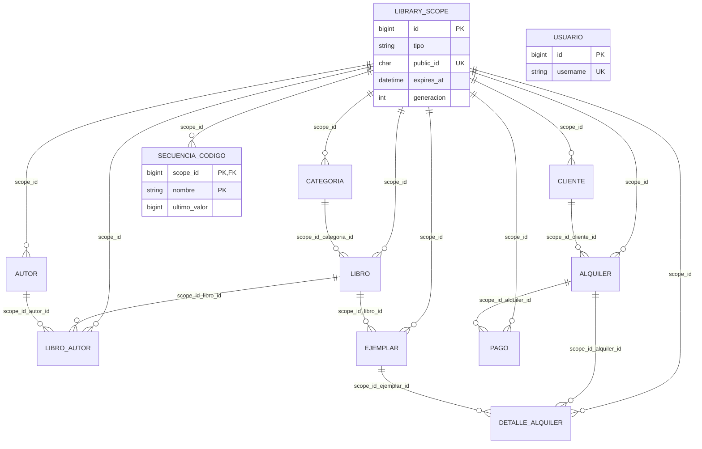

# Hogwarts Library V2.3.1 · Fundamentos del modelo por ámbito

26 de noviembre de 2026 · Java 21 · Spring Boot 4.1.0

## Resultado y estado inicial

Se incorporó el modelo por ámbito y la migración Liquibase 004. Las rutas actuales usan el ámbito reservado `LEGACY` (`1`). El prototipo JPA cubre los vínculos libro–autor, el detalle de alquiler y la secuencia de ejemplares. La configuración `APP_SANDBOX_ENABLED` arranca en `false` y todavía carece de consumidores en tiempo de ejecución.

El trabajo partió de `feature/v2.2.1-hardening` en `e90decb`, con `INTERACTIVE_DEMO_V2.3_PLAN.md` como único archivo local sin seguimiento. El plan se preservó. Su SHA-256 es `01d30fbe7909bb2792347c4d51e99818345a507764dad8eadc387e94ccdfcc6e`. La rama local de trabajo es `feature/v2.3-interactive-sandbox`. Las pruebas usaron bases descartables en loopback. Git conserva el mismo HEAD y el trabajo queda en el árbol local.

## Modelo e identificadores

`library_scope` mantiene la PK interna `BIGINT`, tipo, identificador público único, marcas UTC de creación, vencimiento, cierre y última restauración, generación, fecha de negocio, versión de semilla y contadores de mutaciones y restauraciones. Los índices `(tipo, expires_at, id)` y `(tipo, closed_at, id)` preparan el acceso por ciclo de vida. Para `LEGACY`, el identificador público y el vencimiento quedan vacíos. Para futuras sesiones, la aplicación fijará un vencimiento absoluto de 30 minutos a partir del reloj de la base al confirmar el aprovisionamiento. La migración de esta fase solo crea la fila reservada.

El identificador público de cada sesión será una cadena opaca de 32 caracteres hexadecimales generada a partir de 16 bytes de un CSPRNG, con unicidad SQL y reintento en caso de colisión. El JWT sandbox futuro identificará la sesión mediante esa cadena. El `scope_id` interno se resolverá en servidor. Los IDs de negocio existentes conservan su PK y su representación JSON para privado y lectura. El contrato sandbox deberá usar cadenas decimales para IDs `BIGINT` de negocio en rutas, DTO y respuestas antes de abrir escrituras. JavaScript pierde precisión por encima de `2^53 − 1` y el rango de `BIGINT` lo supera. Los saltos de asignación y caché de TiDB hacen insuficiente extrapolar el valor futuro por conteos de filas. [AUTO_INCREMENT en TiDB Cloud](https://docs.pingcap.com/tidbcloud/auto-increment/)

## Migración e historial

La raíz privada incluye primero el maestro histórico. La raíz pública comprueba el esquema exacto `hogwarts_library_demo` e incluye primero la raíz demo histórica. Las dos aplican después los mismos 74 changesets del bloque 004.

1. Crear `library_scope` y reservar `LEGACY=1`.
2. Añadir las diez columnas `scope_id` admitiendo nulos. Asignar a `LEGACY` mediante actualizaciones que conservan todas las PK y referencias. Verificar la fila reservada, el contador de ejemplares, los conteos fuera de `LEGACY` y los huérfanos en las ocho relaciones antes del DDL obligatorio.
3. Aplicar `NOT NULL`. Crear claves candidatas e índices de hijos en el orden de las futuras FK. Añadir las unicidades por ámbito.
4. Instalar las FK al ámbito y las FK compuestas. Migrar la secuencia mediante una tabla nueva, validar la copia y hacer el cambio de nombres en una sola instrucción.
5. Verificar cada índice único equivalente antes de retirar la restricción global de nombre de categoría, nombre completo de autor, DNI, ISBN y código. Verificar las 18 FK nuevas en el catálogo.

Los changelogs 001–003, sus raíces históricas, sus seis `validCheckSum` y el SQL ficticio permanecen idénticos a `e90decb`. Liquibase conserva rutas, IDs, autores y checksums. El upgrade privado prueba las seis huellas originales registradas en `DATABASECHANGELOG`. El upgrade demo prueba el historial y el contenido sembrado por la versión vigente. La semilla sigue ejecutándose antes de introducir las columnas de ámbito obligatorias.

### Restricciones e índices

| Área | Cobertura |
| --- | --- |
| Tablas con PK de negocio | Clave única `(scope_id, id)` que sirve para referenciar padres y recorrer filas del ámbito. |
| FK de negocio | Ocho FK `(scope_id, <padre>_id)` hacia claves candidatas `(scope_id, id)`. Cada hija tiene el índice correspondiente antes del alta de su FK. El catálogo de MySQL confirmó los ocho prefijos esperados y cero índices implícitos para las FK de 004. Pagos usa `(scope_id, alquiler_id, fecha, id)`. |
| Integridad del ámbito | Diez FK simples de `scope_id` a `library_scope.id`. La raíz bloquea la ejecución con comprobación referencial deshabilitada. |
| Unicidad natural | `(scope_id, nombre)`, `(scope_id, nombre_completo)`, `(scope_id, dni)`, `(scope_id, isbn)` y `(scope_id, codigo)`. Se mantiene la collation de cada columna. |
| Vínculos y detalles | Pares `(scope_id, libro_id, autor_id)` y `(scope_id, alquiler_id, ejemplar_id)` únicos. Los índices históricos de pares y las FK simples se conservan. Las PK globales de los padres hacen equivalentes las unicidades de esos pares. |
| Secuencia | PK `(scope_id, nombre)` y FK al ámbito. La copia hereda charset y collation de `nombre` consultando los metadatos. |

TiDB exige índices de padres e hijos en el mismo orden y puede crear un índice implícito si falta el de la hija. Su documentación también indica que no admite retirar una PK agrupada, lo que motivó el cambio de tabla de la secuencia. Se conserva el original con el nombre `secuencia_codigo_pre004` como copia de corte. Los contadores en esa copia quedan estáticos después del cambio. [FK en TiDB](https://docs.pingcap.com/tidb/stable/foreign-key/) · [PK en TiDB](https://docs.pingcap.com/tidb/stable/constraints/) · [Cambio de nombres de tablas en TiDB](https://docs.pingcap.com/tidb/stable/sql-statement-rename-table/)

## Mapeo JPA

- Las entidades de negocio escriben una sola columna `scope_id` al insertar. Las asociaciones siguen usando las PK globales existentes. El motor valida las FK compuestas en cada escritura. El filtro Hibernate autoactivado limita las consultas de negocio a `LEGACY`, incluida la carga por PK. La prueba con filas de otros ámbitos cubre carga por ID, existencia, listas, búsquedas naturales, lotes, lock de alquiler y agregación de pagos. `Usuario` queda fuera de este modelo. El filtro es una medida transitoria para las rutas actuales. Los accesos nativos y la superficie de persistencia de sandbox necesitarán ámbito explícito en V2.3.2. [Filtros Hibernate](https://docs.jboss.org/hibernate/orm/7.0/introduction/pdf/Hibernate_Introduction.pdf)
- `LibroAutor` reemplaza el `ManyToMany`. La clave embebida escribe el ámbito y `@MapsId` vincula los IDs del libro y del autor. El libro valida el ámbito del autor antes de modificar sus vínculos. Conserva los que siguen presentes y elimina huérfanos. El mapper mantiene el orden de autores por ID en las respuestas.
- `Alquiler.agregarDetalle` verifica el ámbito del ejemplar, fija el ámbito del detalle y mantiene ambos lados de la asociación. Se conserva la cascada y el borrado de huérfanos. Una prueba carga el alquiler con lock, valida su detalle y comprueba que al quitarlo se conserva el ejemplar.
- `SecuenciaCodigo` usa `@IdClass`. El generador actual toma `PESSIMISTIC_WRITE` sobre `(1, EJEMPLAR)`. El prototipo permite bloquear el contador de un ámbito explícito. `LibraryScopeRepository` permite bloquear una fila de ámbito por PK. La prueba de concurrencia usa `READ COMMITTED` y confirma que otro ámbito puede avanzar mientras el primero está bloqueado. No cambia el aislamiento por defecto de la instalación privada.

Hibernate conserva `ddl-auto=validate` y `open-in-view=false` en ejecución. Las pruebas H2 históricas siguen con su esquema de prueba generado. Las comprobaciones de constraints e índices emplean MySQL.

## Validación por entorno

La suite final ejecutó **83 pruebas**, con cero fallos, errores u omisiones. Incluye las 74 pruebas existentes y nueve pruebas nuevas. Los dos recorridos de demo usaron MySQL con transporte seguro obligatorio.

| Entorno o recorrido | Evidencia |
| --- | --- |
| MySQL 8.0.43 privado vacío | Raíz privada desde cero, 88 changesets y arranque con Hibernate `validate`. |
| MySQL 8.0.43 privado actualizado | 14 changesets preexistentes, seis checksums originales admitidos, comparación íntegra de filas con IDs y usuarios, ámbito `1`, contador 47 y arranque con Hibernate `validate`. Login ADMIN y EMPLEADO y acceso de consulta. La raíz pública rechaza el esquema privado. |
| MySQL 8.0.43 demo vacía | 89 changesets. Semilla histórica, cuatro vínculos, contador 6, Hibernate `validate`, login DEMO, consulta y health. Arranque con `VERIFY_IDENTITY` y sesión TLS verificada. |
| MySQL 8.0.43 demo actualizada | 15 changesets preexistentes y comparación de las filas históricas completas. Conserva fechas originales de semilla, IDs, contador y metadatos Liquibase. La prueba confirma que DEMO puede consultar y que las escrituras y el alta de sesiones reciben 403. |
| Reinicio Liquibase | Reejecución de las raíces tras el upgrade privado y los dos recorridos demo. Los registros de `DATABASECHANGELOG` permanecen idénticos. |
| Aislamiento y concurrencia MySQL | En ámbitos 2 y 3 se admiten los mismos nombres, DNI, ISBN y códigos. Se rechazan los duplicados en un ámbito y las referencias cruzadas en las ocho relaciones. Los locks por ámbito y secuencia bloquean al segundo escritor de la misma fila, y el otro ámbito avanza. Contadores finales 44 y 82. |
| Regresión privada MySQL | Los servicios normales crean y editan un libro con autores, generan código de ejemplar, persisten el alquiler y registran un pago dentro de `LEGACY`. Se vuelve a consultar todo tras vaciar el contexto de persistencia. |
| Recuperación MySQL | Se simuló un DDL confirmado sin fila Liquibase. La migración se detuvo en la columna duplicada. Tras revertir únicamente la columna preparada para el ensayo, 004 continuó y conservó los datos. |
| TLS | El perfil hosted mantiene `VERIFY_IDENTITY`. El arranque demo nuevo negoció TLS con el CA de prueba. Connector/J rechazó el hostname que carecía de SAN y una cadena sin autoridad de confianza. |
| H2 y suites existentes | Se ejecutaron las pruebas unitarias y de seguridad existentes. Cubren autorización ADMIN y EMPLEADO, rechazo de escrituras DEMO, login, reglas comerciales, CORS y health. H2 complementa las pruebas MySQL. |
| TiDB | Pendiente de ejecución. No se dispuso de un entorno TiDB descartable autorizado. |
| Recursos y rendimiento | Pendientes las mediciones con volumen representativo, presupuesto de 512 MB, latencia de red y RU. |

Las pruebas nuevas de historial se activan con `V231_PRIVATE_UPGRADE_URL`, `V231_DEMO_UPGRADE_URL`, `V231_DEMO_FRESH_URL` y `V231_PARTIAL_DDL_URL`. Estas variables deben apuntar a esquemas vacíos y los dos recorridos demo requieren instancias distintas por la guarda de nombre. Las pruebas de persistencia emplean `MIGRATION_DB_URL` y las credenciales locales del perfil `migration`. Ejecutar `mvn -o test` con las variables de prueba y, si la JVM restringe la carga dinámica de Mockito, adjuntar el JAR de `mockito-core` con `-DargLine=-javaagent:<ruta-al-jar>`.

### Diferencias de motor y riesgos pendientes

- En MySQL se observó espera por fila en transacciones explícitas con RC. En TiDB hay que comprobar que las transacciones del pool son pesimistas, que `READ COMMITTED` surte efecto y que Connector/J y Hibernate emiten un lock compatible. TiDB carece de gap locks y sus comprobaciones FK pueden bloquear padres de forma distinta. La operación debe bloquear filas existentes con búsquedas puntuales y seguir el orden ámbito → alquiler, ejemplares o secuencia. [Transacciones pesimistas TiDB](https://docs.pingcap.com/tidb/stable/pessimistic-transaction/) · [Aislamiento TiDB](https://docs.pingcap.com/tidb/stable/transaction-isolation-levels/)
- Calificar en la versión TiDB objetivo los cambios de nulabilidad, los índices y FK de cada hija, el DDL de preparación de secuencia con valores de catálogo, el cambio de nombre atómico y las cargas ORM. El repositorio de TiDB incluye una prueba de `PREPARE` de `CREATE TABLE` sin parámetros. La documentación de errores enumera límites sobre DDL preparado y la prueba de Starter sigue siendo necesaria. [Prueba del repositorio TiDB](https://raw.githubusercontent.com/pingcap/tidb/master/tests/integrationtest/t/executor/prepared.test) · [Códigos de errores TiDB](https://docs.pingcap.com/tidb/stable/error-codes/)
- Medir el backfill de tablas privadas grandes. La actualización actual es transaccional. Un volumen mayor podría requerir backfill por lotes y una ventana de mantenimiento ajustada antes del corte. Medir también el plan de consultas del filtro y la carga de autores mediante la nueva entidad de vínculo. La comprobación de arranque y del funcional local no mide latencia ni recursos de hosting.

## Recuperación ante DDL parcial

1. Mantener fuera de servicio las escrituras y el proceso anterior. Obtener un respaldo restaurable antes del corte y guardar conteos, IDs, máximo de secuencia y definiciones de tablas.
2. Localizar el primer changeset sin registrar y cotejar `DATABASECHANGELOG`, `SHOW CREATE TABLE`, `SHOW INDEX` y las vistas de constraints. Verificar que no queda una migración activa antes de operar sobre un lock Liquibase.
3. Si el DDL faltante coincide exactamente con una adición todavía vacía y sin dependencias, revertir solo ese objeto tras contrastar el catálogo. Si ya hay datos o dependencias, recuperar o reconciliar sobre un clon con DDL y DML revisados. Si la secuencia ya cambió de nombre, comparar ambas definiciones y todos los contadores antes de revertir los nombres o rescatar el contador activo. Un cambio de nombre sin registro de Liquibase requiere reconciliar ambos nombres antes de reintentar.
4. Ejecutar 004 de nuevo con la raíz del perfil, comprobar historial e integridad y arrancar con Hibernate `validate`. Mantener las comprobaciones referenciales activas durante la intervención. El ensayo MySQL cubrió el caso de una columna adicional confirmada sin registro.

## Rollback operativo

Mantener V2.3 en modo de solo lectura pública y con el flag apagado es la primera opción de recuperación compatible con el esquema expandido. Si es imprescindible volver al binario V2.2, pausar el tráfico y restaurar en otro esquema el respaldo anterior al 004. Verificar recuentos, IDs, datos, autenticación y valor de secuencia antes de cambiar la conexión. Si hubo escrituras privadas posteriores al corte, conservar el esquema migrado y reconciliar esas escrituras o preparar una migración inversa verificada en un clon. La copia `secuencia_codigo_pre004` no contiene incrementos posteriores. Las columnas `scope_id NOT NULL` obligan a preparar un esquema compatible para las escrituras V2.2. Ante futuras sesiones, cualquier retorno a V2.2 exige además verificar que las tablas accesibles contienen exclusivamente `LEGACY`.

## Archivos modificados

| Área | Archivos |
| --- | --- |
| Modelo | `LibraryScope.java`, `LibroAutor.java`, `Alquiler.java`, `Autor.java`, `Categoria.java`, `Cliente.java`, `DetalleAlquiler.java`, `Ejemplar.java`, `Libro.java`, `Pago.java`, `SecuenciaCodigo.java` |
| Persistencia y servicios | `LibraryScopeRepository.java`, `SecuenciaCodigoRepository.java`, `LibroMapper.java`, `AlquilerServiceImpl.java` |
| Liquibase | `db.changelog-v2.3-private.yaml`, `db.changelog-v2.3-public.yaml`, `changes/004-scoped-foundation.yaml` |
| Perfiles | `application.properties`, `application-demo.properties`, `application-migration.properties` |
| Pruebas e informe | `ScopedMigrationHistoryTest.java`, `ScopedPersistenceMysqlTest.java`, `V2.3.1_FOUNDATION_REPORT.md` |

## Criterios y siguiente fase

- **Cumplidos en MySQL**. Instalación y upgrade, historial y datos preservados, FK y unicidad por ámbito, mapeo JPA con cascadas, bloqueo por ámbito, flujos privado y demo de lectura, TLS local y prueba de recuperación.
- **Pendientes de calificación**. TiDB descartable, métricas con infraestructura representativa y ensayo completo de restauración operativa con respaldo, reanudación y cambio de binario.
- **V2.3.2**. Dar a los servicios una superficie de repositorios con ámbito explícito para búsquedas, escrituras, agregados, bloqueos y cargas de asociaciones. Incorporar pruebas A/B por operación y comprobar ausencia de contexto. Calificar TiDB y el presupuesto de recursos antes de avanzar a la admisión, expiración, purga y JWT sandbox.
